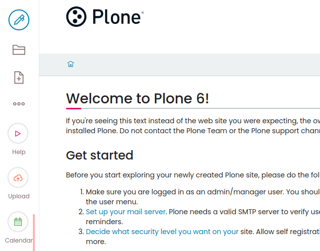

# @eeacms/volto-toolbar-actions

[](https://github.com/eea/volto-toolbar-actions/releases)
[](https://ci.eionet.europa.eu/view/Github/job/volto-addons/job/volto-toolbar-actions/job/master/display/redirect)
[](https://sonarqube.eea.europa.eu/dashboard?id=volto-toolbar-actions)

[Volto](https://github.com/plone/volto) Toolbar extra actions for **Site Administrators**

## Features



### Demo - How to add a toolbar action via ZMI


1. Go to [ZMI > portal_actions](http://localhost:8080/Plone/portal_actions/manage_main)
1. Add a new **CMF Action Category** called **toolbar_top_actions** or **toolbar_bottom_actions**
1. Within this category add a new **CMF Action** called **help**
1. Edit **help**
   * **Title:** `Help`
   * **URL (Expression):** `string:${portal_url}/help`
   * **Icon (Expression)** `string:play circular orange large` See [Semantic UI Icon](https://react.semantic-ui.com/elements/icon/) for more icons variations. Aditionally you can provide:
     * `no-title` - to hide the action title
     * `no-icon` - to hide the action icon
   * **Condition** `python:'/help' not in plone_context_state.object_url()` See [ContextState](https://github.com/plone/plone.app.layout/blob/master/plone/app/layout/globals/context.py#L31) available methods
   * **Permissions** `Modify portal content`

## Requirements

### Backend

- [Plone](https://plone.org/download)
- [plone.restapi](https://pypi.org/project/plone.restapi/)

### Frontend

- Node.js: `>=22.0.0`

## Installation

1. Make sure you have a [Plone backend](https://plone.org/download) up-and-running at http://localhost:8080/Plone

   ```Bash
   docker compose up backend
   ```

1. Start Volto frontend

* If you already have a volto project, just update `package.json`:

   ```JSON
   "dependencies": {
       "@eeacms/volto-toolbar-actions": "*"
   }
   ```

   and `volto.config.js`:

   ```JavaScript
   const addons = ['@eeacms/volto-toolbar-actions'];
   ```

* If not, create one with Cookieplone, as recommended by the official Plone documentation for Volto 18+:

   ```
   uvx cookieplone project
   cd project-title
   ```

1. Install or update dependencies, then start the project:

   ```
   make install
   ```

   For a Cookieplone project, start the backend and frontend in separate terminals:

   ```
   make backend-start
   make frontend-start
   ```

1. Go to http://localhost:3000

1. Happy editing!

## License

See [LICENSE.md](LICENSE.md) for details.

## Funding

[European Environment Agency (EU)](http://eea.europa.eu)
